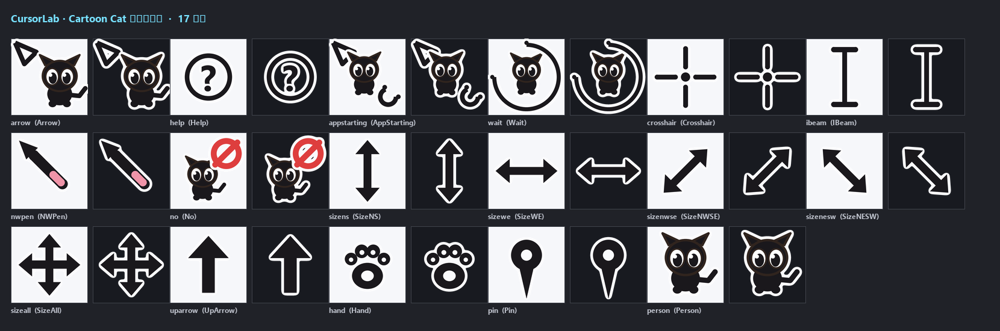

<div align="center">

# 🐾 CursorLab · 卡通小黑猫鼠标指针

**一只大头黑猫 + 两只超大白眼睛的 Windows 指针包**，外加一套「任意图片 → 指针包」的流水线

从造型绘制、`.cur`/`.ani` 二进制编码，到用户级安装脚本，全部自己写，不依赖第三方指针工具。




</div>

## 造型

黑身、棕黑描边、外套一圈 1px 米白（任何壁纸上都不糊）；两只超大白眼睛几乎占满脸，各自一颗黑瞳加高光；小身体缩在头下露出两只圆爪，尾巴细长微卷。

指针方向靠左上角一枚**空心小三角 ▷** 交代，尖端就是点击点。

| 场景 | 造型 | 文件 |
|---|---|---|
| 正常指向 | ▷ + 黑猫（猫在右下） | `arrow.cur` |
| 帮助 | 空心圆 + 大问号 | `help.cur` |
| 后台启动 | ▷ + 黑猫 + 小转圈 | `appstarting.ani` |
| 系统忙 | 黑猫 + 外圈旋转箭头（8 帧） | `wait.ani` |
| 文本输入 | 细 I 型杆 | `ibeam.cur` |
| 十字定位 | 细十字 + 中心点 | `crosshair.cur` |
| 悬停链接 | 猫爪印（肉垫镂空） | `hand.cur` |
| 禁止 | 小红黑猫 + 红色禁行符 | `no.cur` |
| 上下 / 左右 / 斜向 / 四向 | 双头箭头 | `sizens/sizewe/sizenwse/sizenesw/sizeall.cur` |
| 向上 | 上箭头 | `uparrow.cur` |
| 手写笔 | 笔 + 粉色握笔环 | `nwpen.cur` |
| 定位图钉 | 图钉（中间镂空） | `pin.cur` |
| 用户 | 大号黑猫全身 | `person.cur` |

## 装到自己电脑上

**方式一：仓库内直接装**

```powershell
powershell -ExecutionPolicy Bypass -File install.ps1
```

**方式二：发行包（发给朋友）**

1. 下载 [Releases](../../releases) 里的 `cartoon-cat.zip`
2. 解压，双击 `安装.bat`

两种方式都**不需要管理员权限**（只动 `HKCU\Control Panel\Cursors`），安装前自动把原设置备份成 `backup-cursors.json`。

**还原**

```powershell
powershell -ExecutionPolicy Bypass -File uninstall.ps1
```

装好后在 `设置 → 蓝牙和其他设备 → 鼠标 → 其他鼠标设置 → 指针`，主题下拉里能看到 `CursorLab cartoon-cat`。

## 自己定制一套

任何风格都能做：二次元、AI 生成、自己画的、截图都行。

**1. 准备素材** —— 17 张 png 按角色名命名（`arrow.png`、`hand.png`…），丢进一个文件夹：

```
assets/my-cat/
├── arrow.png
├── hand.png
├── wait_0.png   # 动画按 wait_0 ~ wait_7 命名即自动识别
├── wait_1.png
└── person.png
```

**2. 一条命令生成**

```powershell
python tools/make_theme.py --name my-cat --src assets/my-cat
```

自动抠纯色背景、加 1px 白描边、生成多尺寸（32/48/64）、打包成 `dist/my-cat.zip`。

**3. 校准点击位置（热点）** —— 打开 `tools/hotspot.html`，指到 `out/my-cat/png/`，每张图点一下"点击生效点"，把导出的 JSON 贴回 `themes/my-cat/theme.json` 的 `hot`。

**4. 装上去**

```powershell
powershell -ExecutionPolicy Bypass -File install.ps1 -Dir out\my-cat -Name "My Cat"
```

`theme.json` 支持的开关：

| 字段 | 说明 |
|---|---|
| `sizes` | 每张 `.cur` 里塞几种尺寸，默认 `[32, 48]` |
| `outline` | 自动加白描边（暗色桌面更容易看见） |
| `cut_background` | 自动抠掉纯色背景 |
| `delay_ms` | 动画帧间隔，默认 90ms |
| `roles.<角色>.hot` | 热点坐标，按 32 格网格记 |
| `roles.<角色>.frames` | 多帧图片列表（顺序即播放顺序） |

## 技术笔记

<details>
<summary><b>.cur 里只能放 DIB 位图，放 PNG 就是坏文件</b></summary>

`.ico` 从 Vista 起支持 PNG 压缩帧，`.cur` 不支持。而 Pillow 的 ICO 写入器在尺寸 ≥ 64 时会自动改用 PNG —— 直接把文件头改成 2 当 `.cur` 用，Windows 会加载失败。

所以自己实现了 `dib32()`：BITMAPINFOHEADER（高度写 `2*h`，上半 XOR 颜色、下半 AND 透明掩码）+ 自下而上的 BGRA。
</details>

<details>
<summary><b>热点藏在目录项的 planes / bitCount 字段里</b></summary>

`.cur` 的目录项结构和 `.ico` 一样，只是 `wPlanes` / `wBitCount` 被挪用存热点 `<x, y>`（判定类型靠文件头里的 type=2，不是扩展名）。
</details>

<details>
<summary><b>.ani 是 RIFF/ACON 容器</b></summary>

```
RIFF <size> ACON
├── anih  36 字节头：帧数、步数、默认速率(jiffies, 1/60 秒)、flags=1
├── rate  每帧速率
├── seq   播放顺序
└── LIST <size> fram
    ├── icon <size> 一帧 .cur 的完整字节
    └── ...（块长度为奇数时补 0 对齐）
```
</details>

<details>
<summary><b>卡通造型塞进 32px 的三个技法</b></summary>

1. **每档尺寸单独绘制 + 8 倍超采样后 LANCZOS 缩小** —— 直接缩会糊，先画大再缩才有平滑边缘
2. **每个元素单独成层、单独加外描边** —— 猫脸、身体、指针三角各画一层，各自膨胀 alpha 再缩小；否则元素会粘成一坨
3. **点阵 spinner 在小尺寸会糊成斑块** —— 改用旋转圆弧（arc + 两端圆点）才清晰

膨胀 alpha 用「高斯模糊后阈值」而**不是**大核 MaxFilter：35×35 的 rank filter 跑 17 个造型 × 3 档尺寸要几分钟，高斯只要 2 秒。
</details>

<details>
<summary><b>PowerShell 5.1 的三个坑（都踩了）</b></summary>

1. `.ps1` 没有 UTF-8 BOM 时按 ANSI 读，中文注释会把引号吃掉 → 整个脚本语法错误。
2. `Get-Item HKCU:\...` 返回的键是**只读**打开的，`.SetValue()` 会抛「无法写入到注册表项」，要用 `[Microsoft.Win32.Registry]::CurrentUser.OpenSubKey($path, $true)`。
3. 注册表「默认值」的名字是**空字符串**，`ConvertFrom-Json` 遇到空属性名直接报错；备份时改存 `__default__`，读取用 `JavaScriptSerializer`。
</details>

## 目录结构

```
cursorlab/            核心库
├── encode.py         .cur / .ani 二进制编码（DIB、热点、RIFF）
├── cartoon.py        卡通小黑猫 17 个造型（矢量绘制 + 超采样）
└── build.py          主题构建、预览图、zip 打包
tools/
├── make_theme.py     任意 png → 主题（抠图/描边/多尺寸/打包）
├── hotspot.html      点点鼠标标热点，导出 JSON
└── preview.py        出预览图（4 倍放大 + 1:1 真实尺寸）
themes/               图片主题（themes/<名>/theme.json + png）
docs/                 Pages 落地页 + 每轮设计稿
install.ps1           安装（写 HKCU + 立即生效 + 自动备份）
uninstall.ps1         还原
tests/test_encode.py  编码器自测（CI 里跑）
```

构建全部主题：

```powershell
python -m cursorlab.build
```

## 版本

| 版本 | 内容 |
|---|---|
| v0.1.0 | 像素风小黑猫（已归档，仍可在 Releases 下载） |
| **v2.0.0** | 卡通风重做：大头 + 超大白眼 + 分层米白描边 + 空心三角指针 |

## License

[MIT](LICENSE) · 造型可随意改，欢迎提 PR 加主题。
